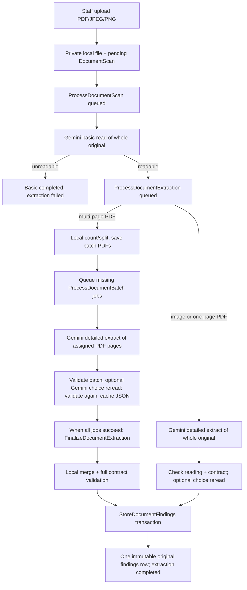

# AI scanner architecture and performance audit

**16 October 2026 · Repository review only.** No application code, schema, prompt, model, or customer data was changed; no Gemini request was made. `C` below means confirmed by code, `I` means an inference from code, and `U` means unverified without production telemetry or a labeled accuracy sample. Paths and line numbers refer to this repository at review time.

## Executive assessment

**The pipeline has useful safeguards but more stages than its evidence currently justifies (I).** The separate whole-document basic call and the whole-batch visual reread overlap detailed extraction. The queue architecture can process batches concurrently, but only when multiple worker processes are running. Per-page evidence, the structured contract, private originals, reusable validated batches, and an atomic final write are valuable and should remain. The repository does not demonstrate an accuracy gain from the extra AI calls, nor does it contain usable latency, token, or cost measurements (U).

## A. Current processing flow

1. [Documents/Index.php](../../app/Livewire/Documents/Index.php) `processDocument()` authorizes active staff, validates MIME, extension, and size (default 10 MB), stores the original on the private `local` disk, creates `DocumentScan`, and dispatches `ProcessDocumentScan`. A failed DB insert removes the file; failed dispatch marks the scan failed. The original download is authorized by [DocumentFileController.php](../../app/Http/Controllers/DocumentFileController.php); [DocumentScanPolicy.php](../../app/Policies/DocumentScanPolicy.php) permits any active staff member, not only the uploader (C). [routes/web.php](../../routes/web.php) applies `auth` and `active` middleware.
2. [ProcessDocumentScan.php](../../app/Jobs/ProcessDocumentScan.php) `handle()` marks basic processing, calls `GeminiDocumentReader::read()`, stores type/title/summary/readability/limitations and completion time, then queues `ProcessDocumentExtraction` only if readable. Basic `status=completed` can coexist with `extraction_status=failed` (C). The summary is not the findings record.
3. [ProcessDocumentExtraction.php](../../app/Jobs/ProcessDocumentExtraction.php) `handle()` marks extraction processing. For PDFs, `GeminiDocumentReader::preparePdfBatches()` calls [PdfPageBatches.php](../../app/Services/PdfPageBatches.php) `make()` to count pages locally and split them into two-page groups by default. FPDI copies page content into new PDFs; compressed cross-reference PDFs fall back to [split_pdf.py](../../app/Services/split_pdf.py) with `pypdf`. **There is no local page raster rendering** (C). All groups are rebuilt and their `.pdf` files rewritten on an extraction retry, even when a `.json` result is reusable (C).
4. For more than one PDF page, the coordinator submits every missing group to one Laravel `Bus::batch`, with no wave limit. Each [ProcessDocumentBatch.php](../../app/Jobs/ProcessDocumentBatch.php) job sends only its assigned PDF pages, validates range and V1 structure, optionally rereads that same group for choice marks, validates again, and atomically moves temporary JSON to a `.json` cache. The batch `then` callback queues [FinalizeDocumentExtraction.php](../../app/Jobs/FinalizeDocumentExtraction.php) after all jobs succeed. Valid cached groups are skipped on a manual extraction retry (C).
5. `GeminiDocumentReader::mergePdfBatches()` loads cached JSON in page order, rewrites IDs, merges sections/entities by keys, checks page order, and validates the combined object. It makes **no Gemini call**. `StoreDocumentFindings::store()` validates once more, locks the scan, inserts one [document_findings](../../database/migrations/2026_10_16_110413_create_document_findings_table.php) row and sets `extraction_status=completed` in one transaction. A unique scan foreign key and an existing-findings guard prevent a second original row (C). No Customer Profile write path is present in this flow.
6. [Documents/Show.php](../../app/Livewire/Documents/Show.php) and its [view](../../resources/views/livewire/documents/show.blade.php) poll and display basic/extraction statuses, batch markers, findings, errors, and manual retry actions. Batch status comes from local `.pdf`, `.running`, `.failed`, and `.json` files, not queue reservations; stale files after a size change can mislead the UI (C).

Sequential dependencies: upload → basic read → extraction setup → detailed calls → optional verification → merge → final write. Within one batch job, extraction and verification are serial. Separate batch jobs overlap **only across worker processes**. The private `extractPdf()` loop at [GeminiDocumentReader.php:43](../../app/Services/GeminiDocumentReader.php#L43) would run sequentially, but the normal queued multi-page path dispatches jobs instead; repository caller search found no direct caller for that loop (C).

## B. Gemini API call inventory

All operations use `POST /v1beta/interactions`, inline base64 source plus text prompt, `store=false`, JSON response schema, model `config('services.gemini.model')`, 10-second connection timeout and 75-second total HTTP timeout ([GeminiDocumentReader.php:438](../../app/Services/GeminiDocumentReader.php#L438), [services.php](../../config/services.php)). The code sets **no output-token cap, thinking setting, per-call usage logging, or HTTP client retry**. The default model is `gemini-3.8-flash`; the local `.env` selects `gemini-3.1-pro-preview` (C, deployment may differ). Non-2xx responses log status and `Retry-After` but do not wait for that header.

| Operation | Input / prompt responsibility | Expected result and reuse | Retries / execution |
|---|---|---|---|
| Basic `read()` ([line 402](../../app/Services/GeminiDocumentReader.php#L402)) | Entire original PDF/image; classify, title, short summary, readability, limitations | Five-key JSON saved on scan; four values are repeated as context in each PDF batch prompt; the original is read again for extraction | `ProcessDocumentScan`: up to 3 attempts, random 30–45s then 60–90s backoff. 408/429/5xx and uncaught connection failures can retry; invalid JSON/result and other 4xx become terminal. Serial prerequisite. |
| Detailed `extract()` / `extractPdfBatch()` ([lines 22, 120, 568](../../app/Services/GeminiDocumentReader.php#L120)) | Entire original for image/one-page PDF; only assigned pages for multi-page PDF. Universal V1 prompt asks fields, blanks, options, entities, tables, narrative, page evidence, and page rereview. Each batch repeats the long prompt and basic document context | Full V1 JSON. Validated batch JSON is cached; one-page/image output is not cached separately | One-page/image coordinator has one attempt. Multi-page job has up to 3 attempts, 30s then 90s backoff, regardless of error type. Jobs may overlap across workers. |
| `verifyChoices()` ([line 308](../../app/Services/GeminiDocumentReader.php#L308)) | Same entire image/one-page PDF or assigned batch PDF, plus every already found choice group/option and page number. Rereads all pages for omitted form content | Option states and `coverage_gaps`. Agreement retains original; disagreement becomes ambiguous with an issue. Nonempty gaps fail the attempt. No separate cache; result is folded into batch/final findings | Only when extracted choice fields exist and first structural validation passes. Serial after detail; batch job retry repeats **both** calls. |

The basic read and detailed prompt both identify document purpose and read the source (C); combining them could save one full-document request, but readability gating and a short early summary would be lost or need to be derived from V1 output (I). Verification repeats mark reading and scans whole attached pages despite receiving option IDs and stated page numbers (C). Its independent comparison can catch mistakes, but no evaluation establishes net accuracy benefit (U). Each group returns full V1 scaffolding, repeated document metadata and often empty arrays; no measured output-token waste is available. There is no AI-based whole-document merge or entity reconciliation call (C).

For a successful document with `P` PDF pages and batch size 2, `B=ceil(P/2)` for `P>1`; let `C` be the number of groups containing at least one extracted choice field (`0≤C≤B`). **Calls = `1+B+C`**. An image or one-page PDF uses **2 calls**, or **3** with choices. Fourteen pages use **8–15** calls; 50 pages use **26–51**. These are request counts, not measured cost. A failed group can make up to three detailed attempts; if each reaches verification, up to six calls for that group, plus the basic read (up to three attempts). Manual retries can add more. The basic call sends the full source again; multi-page detailed calls send assigned pages; verification resends those pages. The PDF split itself reads the original locally.

## C. PDF parallelism, bottlenecks, and cost

| Rank | Finding | Evidence and impact |
|---|---|
| 1 | Full-document basic request sits on every successful critical path (C); likely material latency/cost for long PDFs (I). | `ProcessDocumentScan` dispatches extraction only after `read()` completes. No reuse of its pixels/tokens by detailed extraction. |
| 2 | Choice verification is a second serial AI request for every group with choice fields (C); it may dominate such groups (U). | `extractPdfBatch()` calls `verifyChoices()` after detailed response. No duration/usage telemetry. |
| 3 | Queue workers, not an HTTP concurrency setting, determine overlap (C). | `Bus::batch()` queues all jobs; [package.json](../../package.json) `workers` starts five `queue:work` processes. A single `php artisan queue:work` runs one job at a time. Five is a local script convention, not a global limit. Other workers/scans can raise total Gemini concurrency. |
| 4 | Retrying a failed batch repeats potentially expensive deterministic work (C). | `ProcessDocumentBatch` has three attempts for malformed JSON, coverage gaps, schema failure, non-retryable 400, and 429/503 alike. Completed `.json` groups survive; failed group's extraction and verification repeat. |
| 5 | Split/preparation repeats on manual retry and prepares **all** groups before checking cache (C). | `preparePdfBatches()` runs `PdfPageBatches::make()` and rewrites every `.pdf`; fallback can take up to 300s. No timing data. |

One page: no job batch or merge; basic + detailed (+ optional verification) is entirely serial. Fourteen pages: seven two-page jobs are dispatched together; with one worker, all seven are serial; with five idle workers, up to five can run at once, then the remainder, followed by finalization. Fifty pages: 25 jobs are submitted together; five idle workers imply at least five job waves, while queue competition or retries add delay. Batch size is fixed by count, without page complexity, token, or file-size weighting. All jobs share the normal queue; there is no per-scan, per-process, or system-wide API semaphore, wave controller, or `.env` concurrency key (C).

`AI_SCAN_PAGES_PER_BATCH=2` and `DB_QUEUE_RETRY_AFTER=3660` are in [.env.example](../../.env.example); the local `.env` has the same batch size and database retry visibility. Job timeouts are 120s (basic), 3600s (coordinator), 180s (batch), 120s (finalizer); HTTP timeout is 75s per call. The 180s batch timeout covers two serial 75s calls with a small margin for validation/storage. Database `retry_after=3660` exceeds every declared job timeout. Other queue drivers default to 90s visibility in [queue.php](../../config/queue.php), a mismatch if selected without override. One worker does not deadlock on `Bus::batch`: the coordinator queues jobs and returns; it does make them serial. The old 150-second queue setting described in [phase-1-audit.md](phase-1-audit.md) is stale (C).

**Measurements:** The local `database/database.sqlite` contains queue tables but no `document_scans` or `document_findings` tables, so there are no inspectable one-page, 14-page, or successful multi-page records. `storage/logs/laravel.log` on 16 October contains 162 Gemini HTTP failure events (83 HTTP 503, 57 HTTP 400, 21 HTTP 429, one HTTP 401), 68 batch-failure events and six validation-failure events. These are **log-line counts**, may include test or repeated runs, and cannot be treated as production incident or per-document rates. Logs lack stage duration, token usage, response size, and cost. No measured slowest stage, checkbox share, scaling curve, or API spend can be stated. The `processing_started_at`/`processing_completed_at` columns time only basic processing, not detailed extraction. No API pricing is assumed.

To measure: log a scan/job/batch ID, attempt, stage start/end and elapsed time for queue wait, basic HTTP, PDF split, detailed HTTP, visual HTTP, validation, merge, and transaction; record HTTP status, retry cause/backoff, request/response bytes, model, token usage fields when returned, and a rate-card version. Exclude source text, prompts with document data, raw findings, and credentials. Aggregate by page count and document class; distinguish worker queue wait from service latency. A labeled sample with human-reviewed field, blank, choice, entity, table and page coverage is required to measure accuracy and whether each extra call helps.

## D. Accuracy, completeness, and failure risks

The detailed prompt and V1 schema are broadly document-neutral: identity, payslip, bank statement, contract, invoice and ordinary narrative can fit fields/tables/blocks; form-specific directions are prominent but explicitly say not to invent questions for ordinary documents ([GeminiDocumentReader.php:568](../../app/Services/GeminiDocumentReader.php#L568)). Blank questions, printed options, ambiguous/unreadable marks, multiple people, tables and page evidence are represented. Tests include synthetic identity, payslip, bank statement, application, blank/conflicting form and contract fixtures ([DocumentFindingsFixtures.php](../../tests/Fixtures/DocumentFindingsFixtures.php)); these prove contract behavior with mocked AI, not real-world recall or precision (C/U).

Four distinct properties must not be conflated:

| Property | Present check | Limit |
|---|---|---|
| JSON/schema validity | Response JSON parsing, Gemini response schema, `DocumentFindingsV1::validate()` | A well-formed empty `fields` array is valid. Required nullable keys can reject an otherwise useful partial response. |
| Page coverage | Local PDF count for batches; required page records and `reading_status=complete` | The status is Gemini self-report. `validateBatch()` fabricates complete records for out-of-batch pages **only for local validation**; it does not prove those pages were read. |
| Field discovery/completeness | Prompt top-to-bottom rereview; choice verification requests form `coverage_gaps` | Gaps are Gemini self-report, verification runs only when at least one choice was found, and it checks form content rather than arbitrary omitted fields. |
| Extraction accuracy | Structural references, typed values and option consistency | No comparison with ground truth or independent source-evidence check. A valid page number does not prove the claimed value appears there. |

Specific risks (C code path, I consequence): `mergeBatches()` collapses sections by lowercased heading and parent heading and entities by lowercased type/role/display name ([lines 252–285](../../app/Services/GeminiDocumentReader.php#L252)). Different same-name people/sections can be conflated; unnamed or differently named instances remain split. On a collapse, only page/relationship lists are unioned, so other attributes from the later item are discarded. Fields, tables and blocks are appended without cross-batch deduplication or continuation stitching. The final validator catches broken references, not a semantically wrong merge. Batch prompts carry only basic type/title/summary/limitations, not earlier entities or table structure, so independent jobs can assign different IDs/roles across pages. Conversely, using a whole-document extraction could help cross-page relationships but risks a very large response and timeout.

`normalizeChoiceValues()` derives selected IDs from marks before batch validation; it can replace a model's inconsistent normalized choice value without retaining that discrepancy ([line 216](../../app/Services/GeminiDocumentReader.php#L216)). The verification pass does preserve **mark-state disagreement** as ambiguous with an issue, and does not silently choose the second pass ([lines 373–391](../../app/Services/GeminiDocumentReader.php#L373)); a mistaken second pass can still turn a correct answer into ambiguity. A single invalid field, omitted required nullable property, malformed box, or missing reference rejects the entire group/document; no valid partial findings row is written. This protects structural integrity but increases retry/failure exposure. `DocumentFindingsV1` normalizes optional null evidence only; it does not validate semantic completeness. Final storage guarantees one **structurally valid** result with all required page records and complete statuses on the normal paths, not all meaningful source content.

Failure handling differs by stage. Basic malformed JSON/schema is terminal, while 408/429/5xx and uncaught transport failures can use its queue retry. One-page/image detail has one attempt and a manual retry action. Every multi-page batch exception, including deterministic validation and HTTP 400, receives up to three queue attempts. A terminal batch fails the Laravel batch, so finalization is not dispatched; other completed `.json` groups are retained for manual retry. A finalizer failure has one attempt. UI shows basic versus extraction failure, page-group markers, and a summarized error, but no token/time/call diagnostics. Logs may include validation messages and source-derived `coverage_gaps`; access to them should remain restricted. The separate statuses safely retain a successful basic summary after failed detail.

## E. Component evaluation

| Component | Verdict | Reason |
|---|---|---|
| A. Basic understanding call | **MERGE, subject to measurement** | Classification/readability/summary overlap detailed read; currently gates unreadable documents and gives early feedback. Compare accuracy and failure handling before removing. |
| B. Detailed extraction | **KEEP** | Core universal field discovery; prompt/schema output size needs measurement. |
| C. Parallel page batches | **IMPROVE** | Bounded page input and recoverable partial results are valuable; workers provide real overlap, but no global concurrency control or context reconciliation. |
| D. Choice verification | **SIMPLIFY** | Independent mark check is valuable where choices are difficult, but whole-batch reread and coverage sweep are broad and serial. Measure its disagreement quality before narrowing. |
| E. Intermediate validation | **KEEP** | Range, V1 relationships, choice consistency and final integrity have distinct purposes. Avoid repeated full validation when it adds no new boundary. |
| F. Intermediate findings storage | **KEEP** | Validated `.json` per group permits recovery; cache invalidation currently keys only cache version/model and can redo all splitting. |
| G. Cross-batch entity reconciliation | **IMPROVE** | Exact normalized-name matching is cheap but can conflate people and discard attributes; needs evidence-aware conflict handling. |
| H. Whole-document merge | **KEEP** | Deterministic local merge is necessary and API-free; fix semantic risks, preserve provenance. |
| I. Final immutable validation/write | **KEEP** | Transaction, unique constraint and V1 check protect original findings; completeness is a separate requirement. |
| J. Queue/retry orchestration | **IMPROVE** | Needed for long documents; retryability, worker capacity and visibility need alignment. |

No component is proven safe to **REMOVE** outright from this repository alone. There is no measurable evidence that either extra AI pass improves accuracy; that should be resolved with a controlled evaluation, not an assumption that fewer calls always wins.

## F. Current versus minimal target

| Dimension | Current | Proposed target and tradeoff |
|---|---|---|
| Sequence | Full basic AI read, then detailed AI read per group, optional full-group choice reread, local merge, final validation | Secure upload; local count/split; detailed extraction per manageable group; validate/cache; targeted verification for uncertain/high-risk choices; reconcile/merge; final V1 validation and immutable write. Derive summary/classification from findings or a lightweight stage only if tests show a need. |
| Speed/cost | `1+B+C` successful calls, with a whole-original read first; no measured timing or spend | Could remove one serial full-document call and shrink reread input, but targeted verification/cropping has implementation and accuracy costs. Fewer requests may lose whole-document context. |
| Concurrency/recovery | All group jobs dispatched; throughput depends on workers; validated groups cached | Keep queue batch and cache, cap actual concurrent API calls across scans, retry only transient failures. Preserve completed groups. |
| Completeness/accuracy | V1 page records, detailed prompt, optional choice reread, heuristic cross-batch merge | Preserve blank fields/options, entities, tables, page evidence and uncertainty; add explicit page/field coverage evaluation and merge provenance. No automatic Customer Profile changes. |
| Maintainability | Multiple jobs plus duplicate validation and broad prompts | Retain distinct upload, batch, merge and store boundaries; simplify only when a test demonstrates equal or better accuracy. |

## G. Prioritized recommendations

| Priority | Problem and evidence | Correction; expected benefit | Risk / effort |
|---|---|---|---|
| 1 | No trustworthy stage/cost/accuracy metrics; `responsePayload()` discards usage and scan timestamps cover only basic processing | Add privacy-safe stage, HTTP and token metrics plus a human-labeled evaluation set. Enables ranking and measured tradeoffs. | Low–medium; avoid logging document content. |
| 2 | Batch retry repeats deterministic 400, malformed/schema, and coverage failures; `ProcessDocumentBatch` retries all exceptions three times | Classify transient 408/429/5xx/transport versus deterministic validation/4xx; preserve failure detail and successful groups. Reduces wasted calls and delay. | Medium; transient malformed model output may occasionally recover, so validate policy on sample. |
| 3 | Basic full-document call overlaps detailed extraction; `read()` precedes every extraction | Trial deriving type/title/summary/readability from detailed findings while retaining a safe unreadable path; compare cost, latency and accuracy before merging. | Medium–high; loss of early gating and global context may hurt. |
| 4 | Whole-group choice reread can add one serial call per group; `verifyChoices()` rescans all attached pages and only triggers after choices are discovered | Measure mark disagreement/coverage benefit, then test page-targeted verification of uncertain or critical groups, retaining disagreement as an issue. | Medium–high; missed choice groups and crop quality can reduce accuracy. |
| 5 | Name/heading keyed reconciliation can conflate entities, while independent batches can duplicate fields; `mergeBatches()` | Add explicit provenance and a conflict-preserving reconciliation rule/test set for repeated names, unnamed roles, spanning tables and repeated sections. | High; conservative merges can leave duplicates for staff review. |

Secondary: reuse already prepared PDFs on manual retries; make actual cross-scan concurrency explicit rather than relying on worker count; update stale worker guidance. These should follow measurement and reliability work.

## H. Unverified assumptions and evidence needed

- **Past cases:** no local scanner tables, so the reported prior one-page success and 14-page failures cannot be tied to page count, status, attempt, model, or cause. Obtain redacted scan/job IDs, page counts, timestamps, batch statuses and error categories from the actual environment.
- **Latency and price:** no stage timers, response token usage, request sizes or rate-card snapshot. Current bottleneck and estimated API cost cannot be quantified.
- **Accuracy:** synthetic fixtures and mocked HTTP establish mechanics, not field recall, exactness, blank-field coverage, selection precision, entity attribution or table continuity. Compare against human-reviewed originals for each document class and page size.
- **Verifier value:** measure disagreements against ground truth, including false ambiguity and omissions when no choice was discovered.
- **Operations:** deployment worker count, queue driver, Gemini quotas, API response token limits/thinking behavior and live model may differ from local configuration. Verify them before capacity claims.
- **Source evidence:** page number and optional bbox are model-produced assertions. No OCR or pixel-grounded checker independently verifies every field; original files and staff review remain necessary.
